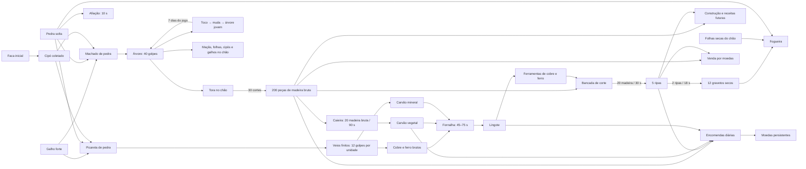

# Recursos, ferramentas e economia

**Estado:** ciclo jogável de madeira, mineração, combustível, fornalha, comércio, ferramentas de metal, contratos diários e crescimento visual das árvores implementado. Progresso, prazos, recompensas e retorno de itens ficam salvos. Valores, preços e ritmo de reposição continuam provisórios.

## Direção do sistema

A coleta deve exigir preparação e tempo, mas cada etapa precisa produzir algo útil ou abrir outra possibilidade. O jogador começa sem ferramenta pesada, consegue reunir materiais à mão e pode fabricar um machado simples. Árvores e seus restos alteram o mundo para todos; os itens recolhidos entram numa mochila com limite real de espaços e uma barra rápida.

Os valores abaixo são uma base de progressão, não uma simulação literal de volume ou massa. O objetivo é tornar o trabalho perceptível sem transformar cada árvore em minutos de cliques repetidos sem decisão.

## Materiais e distinções

| Material | Como aparece | Uso principal |
|---|---|---|
| Graveto seco / lenha pequena | Encontrado no chão ou fatiado de ripas | Um único item para acender, manter e reconstruir fogueiras. |
| Madeira bruta | Extraída ao cortar uma tora | Matéria-prima para ripas e carvão vegetal. |
| Ripa | Produzida na bancada ao cortar madeira bruta | Construções, máquinas, móveis e, se fatiada de novo, gravetos secos. |
| Galho forte | Encontrado no chão | Cabo rudimentar de ferramenta. |
| Folhas secas | Encontradas em pequenos montes | Acendimento da fogueira. |
| Cipó | Recolhido com a faca inicial | Amarrar pedra e cabo no primeiro machado. |
| Pedra solta | Encontrada no chão | Ferramentas simples, fogueira e afiação. |
| Tora | Surge quando uma árvore cai | Precisa de mais cortes para virar materiais de madeira. |
| Toco, muda e árvore jovem | Etapas visíveis após o corte | Marcam a regeneração do mesmo ponto antes da árvore adulta voltar. |
| Maçã | Cai da árvore | Venda; alimentação pode entrar com um sistema de fome futuro. |
| Minério de cobre / ferro | Extraído de veios finitos com picareta | Fundição em lingotes ou venda. |
| Carvão mineral | Extraído de veios escuros com picareta | Combustível direto na fornalha ou venda. |
| Carvão vegetal | Produzido na caieira com madeira bruta | Combustível de fundição ou venda. |
| Lingote | Produzido na fornalha com minério e combustível | Venda ou melhoria de ferramentas na bancada. |

`wood` continua sendo o ID salvo dos gravetos secos para preservar contas antigas; o ID legado `firewood` é convertido para `wood`, pois gravetos e lenha pequena são o mesmo item de fogo neste sistema. `timber` é o novo ID para madeira bruta. A tora não entrega gravetos, lenha e ripas redundantes ao mesmo tempo.

## Mapa de relações

## Ciclo atual da madeira

1. A personagem começa com uma faca simples. Ela permite cortar cipós; gravetos, pedras, galhos fortes e folhas podem ser recolhidos à mão.
2. Um machado de pedra pode ser montado com **1 galho forte, 1 pedra e 1 cipó**, ou comprado na recepção por **500 bronzes**.
3. Com o machado equipado, derrubar uma árvore exige **40 golpes**. Cada golpe consome 1 ponto de durabilidade e 2 pontos de fio.
4. O intervalo começa em **2,5 segundos por golpe**. Com o fio abaixo de 60%, passa a 4 segundos; abaixo de 30%, 6 segundos; sem fio, 8 segundos. R afia o machado em 10 segundos e consome 1 pedra; isso recupera o fio e reduz o tempo dos golpes seguintes, mas não a durabilidade.
5. O machado tem **210 pontos de durabilidade**. Um ciclo completo usa 40 golpes na árvore e mais 30 na tora; portanto, a ferramenta aguenta três ciclos completos antes de quebrar. Afiação não prolonga sua vida útil.
6. Ao cair, a árvore deixa uma tora e itens persistentes no chão: **3 maçãs, 4 montes de folhas secas, 2 cipós e 2 galhos fortes**. Esses são bônus; gravetos secos e lenha pequena continuam sendo um único item. Os itens não entram automaticamente na mochila e voltam junto com a árvore, após sete dias do jogo.
7. A tora exige **30 cortes**. Ao concluir, rende **200 peças de madeira bruta**; nenhuma ripa ou graveto extra aparece automaticamente. A mochila precisa ter espaço para a madeira antes do último corte, empilhada até 99 por espaço.
8. O ponto da árvore muda de aparência durante o retorno: **toco nos primeiros 2 dias**, **muda até o quinto dia**, **árvore jovem até o sétimo**; então a árvore adulta volta. Os prazos são salvos no mundo e continuam correndo durante reinícios. Por enquanto, o crescimento volta ao mesmo ponto e não depende da densidade da floresta.

Uma bancada custa **24 madeira bruta, 8 pedras e 4 cipós**. A madeira passa por duas etapas: 20 peças de madeira bruta viram 5 ripas em 30 segundos; depois, 2 ripas podem ser fatiadas em 12 gravetos secos em 18 segundos. Os gravetos são o mesmo item usado como lenha pequena. A tora não dá gravetos automaticamente; quem quiser bastante lenha precisa gastar mais ripas e tempo de bancada. Cada lote pronto fica no chão até ser recolhido e ocupa espaço próprio na mochila.

Com o fio zerando no golpe 50, um ciclo de 70 golpes leva aproximadamente **6 minutos sem afiar**. Se o jogador recolher uma pedra e afiar quando o machado ficar cego, o ciclo cai para cerca de **4 minutos e 20 segundos no total**, incluindo os 10 segundos da afiação; caminhada e coleta da pedra são tempo adicional.

Cada golpe salvo atualiza o progresso compartilhado da árvore, da tora ou do veio. Reiniciar o servidor não apaga o trabalho já feito. Quando a tora termina, o registro de progresso é removido junto com ela e a madeira só é entregue após salvar o mundo.

## Mochila e atalhos

- A mochila tem **27 espaços** e a barra rápida usa os primeiros **9**.
- Cada espaço empilha só um tipo de item. Limites atuais: madeira bruta e gravetos 99, pedra/minério/carvão 50, ripa/lingote 20 e ferramentas 1.
- I abre a mochila; as teclas 1–9 equipam um espaço da barra. Um item da mochila pode ser movido para a posição selecionada da barra.
- Coletas, receitas e recompensas são recusadas quando a mochila não comporta o resultado completo. Isso evita perder metade de uma pilha ou apagar o recurso do chão sem espaço para guardá-lo.

## Fogueira e economia já existente

Uma fogueira nova custa **20 gravetos/lenha pequena, 10 pedras e 1 maço de folhas secas**. Alimentar uma fogueira fraca custa 2 gravetos. Reacender custa 10 gravetos e 1 maço; reconstruir também exige 5 pedras. Há um único saldo de madeira pequena para fogo, sem uma segunda pilha de lenha.

A carteira de bronze, prata e ouro e a venda na recepção já existem. A escala é 100 bronzes por prata e 100 pratas por ouro. As ferramentas simples estão à venda: machado por 500 bronzes e picareta por 700. Também podem ser fabricadas no bosque. Os preços de materiais são provisórios e precisam considerar o tempo e o número de espaços ocupados por cada material.

O dinheiro entra por venda de material e por quatro encomendas diárias na recepção. Cada conta pode concluir uma vez por dia cada pedido: **20 gravetos por 30 bronzes**, **8 ripas por 120**, **6 carvões vegetais por 52** e **2 lingotes de cobre por 132**. O dia segue o relógio contínuo do mundo (24 minutos reais); os pedidos voltam no próximo dia do jogo, conforme [Tempo do jogo e propriedades](GAME-TIME-AND-HOUSING.md). As recompensas e os registros de conclusão são persistentes. Visitantes podem ver o quadro, mas precisam entrar numa conta para entregar e guardar o pagamento. Os prêmios ficam um pouco acima da venda direta para recompensar processamento e planejamento, sem substituir a venda livre.

## Mineração, combustível e fornalha

`depósito de pedra/minério → golpes de picareta → minério bruto → combustível + fornalha → lingote`

A picareta de pedra pode ser fabricada com **2 pedras, 1 galho forte e 1 cipó**, ou comprada na recepção por **700 bronzes**. Os veios nas serras são recursos compartilhados e finitos. Cada unidade exige **12 golpes de picareta**; uma picareta simples tem 180 golpes de vida e pode extrair até 15 unidades. Cobre e ferro saem como minério bruto; veios escuros dão carvão mineral.

Uma caieira custa **20 madeira bruta, 12 pedras e 4 ripas**. Cada lote consome 20 madeira bruta, leva 90 segundos e entrega 6 carvões vegetais. Uma fornalha custa **25 pedras, 8 madeira bruta e 8 ripas**. Fundir cobre consome 1 minério e 2 carvões vegetais (ou 1 carvão mineral) em 45 segundos; ferro usa a mesma carga e leva 75 segundos. O lingote pronto fica no chão até alguém recolhê-lo; mochila cheia impede a coleta sem apagar o lote.

Na bancada, **3 lingotes de cobre + 2 ripas** melhoram o machado para cobre; **3 lingotes de ferro + 2 ripas** levam ao machado de ferro. Para picaretas, cobre custa **2 lingotes + 2 ripas** e ferro **3 lingotes + 2 ripas**. A melhoria consome a ferramenta anterior e devolve uma nova com durabilidade cheia. O machado de cobre trabalha em **30 golpes por árvore e 22 por tora** (420 de durabilidade); o de ferro, **24 e 18** (630). Ambos gastam fio mais devagar que o de pedra. Picaretas de cobre e ferro exigem, respectivamente, **8 e 5 golpes por unidade**, com 360 e 540 de durabilidade. O objetivo é reduzir trabalho repetitivo, mantendo mineração, fundição e bancada como etapas necessárias.

Minério, carvão e lingotes podem ser vendidos na recepção. Machado e picareta também podem ser comprados ali por **500 e 700 bronzes**. A compra desconta a carteira salva e só termina depois que ferramenta e pagamento forem registrados.

Preços iniciais de venda (bronzes): madeira bruta 1, graveto 1, pedra 1, galho forte 2, frutinha 2, maçã 3, folha seca 1, cipó 2, ripa 12, minério de cobre 5, minério de ferro 8, carvão mineral 4, carvão vegetal 7, lingote de cobre 60 e lingote de ferro 100. São valores para validar o ciclo, não um equilíbrio final.

Uma árvore abatida volta ao mesmo ponto após **7 dias do jogo** (168 minutos reais). É uma reposição lenta para manter o bosque utilizável sem permitir corte contínuo do mesmo ponto. Tocos, mudas e árvores jovens aparecem em estágios visíveis, mas novas árvores em outros pontos e crescimento condicionado à densidade da floresta continuam como evolução futura. Itens pequenos comuns retornam após o intervalo configurado, inicialmente **4 minutos**, com o prazo salvo no mundo; o cronômetro continua contando durante reinícios do servidor. Os bônus de árvore usam o prazo de retorno da própria árvore.

## Etapas restantes

1. Condicionar a regeneração à densidade e ao estado do bosque, além de espalhar mudas para novos pontos.
2. Calibrar preços e prêmios pelos tempos reais de coleta, deslocamento, golpes, fundição e espaços da mochila; os valores atuais são uma primeira curva.

A expansão futura com profissões de NPC, guilda, prefeitura e rotas de abastecimento tem plano incremental próprio em `docs/NPC-SETTLEMENT-ECONOMY-PLAN.md`. Ela começa por um lenhador abastecendo estoque finito que o jogador consegue comprar; não substitui nem reimplementa este ciclo de recursos.

O ciclo jogável liga faca, coleta, machados e picaretas de pedra/cobre/ferro, afiação, desgaste, queda e retorno gradual de árvores, bônus no chão, tora, mochila, barra rápida, mineração, caieira, carvão, fornalha, lingotes, bancada de melhoria, venda e contratos. O trabalho parcial e os prazos ficam no mundo compartilhado; recompensas e entregas ficam salvas por conta. Em instalações PostgreSQL, aplicar a migração `010_resource_contracts.sql`; a modalidade de armazenamento JSON não precisa dela.
