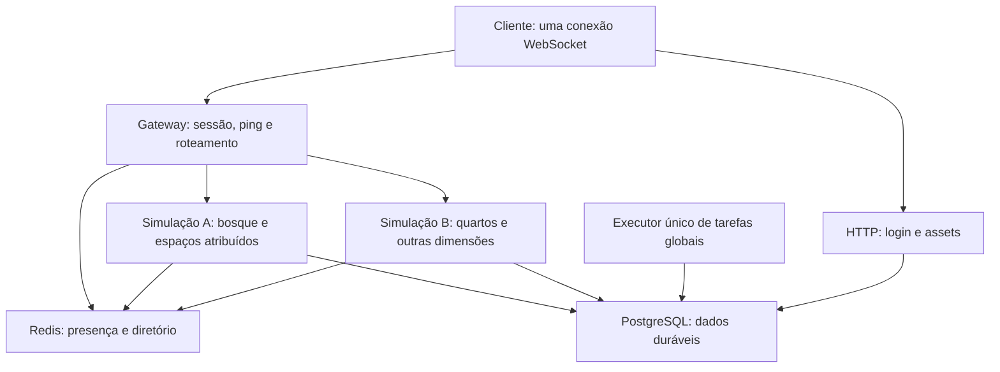

# Separação de conexão e simulação: plano de melhoria

**Estado: proposta para implementação incremental.** Esta análise não instala serviços, altera infraestrutura nem comprova capacidade. Complementa `ROADMAP-1000-PLAYERS.md` com uma primeira arquitetura executável. Manter Canvas 2D, protocolo compatível, simulação autoritativa e persistência atual.

As [Regras de dimensões, chunks, simulação e apresentação](SCENE-RUNTIME-RULES.md) são o contrato das próximas implementações. A matriz de validação distingue o que existe dos requisitos de distribuição ainda pendentes.

## Decisão recomendada

Separar **por responsabilidade e instância**, inicialmente na mesma VPS. Um jogador mantém uma conexão pública; o gateway encaminha suas mensagens para o processo responsável pelo quarto ou dimensão. Começar com um gateway e dois processos de simulação, após extrair e testar o runtime de instância. Isso é uma configuração de experimento, não uma promessa de capacidade nem uma reserva de núcleos.

Não executar duas cópias integrais do servidor atual atrás de round-robin: elas manteriam mundos em memória independentes, poderiam disputar o mesmo espaço e repetiriam timers globais. Afinidade de conexão, sozinha, não resolve autoridade compartilhada.

Objetivo: reduzir p95/p99 de tick, atraso do ciclo, espera de comandos e picos de RTT atribuíveis ao servidor, sem aumentar duplicações, correções de posição, perda de ações ou tempo de viagem. A distância da rota até o jogador continua sendo outro problema.

## Evidência e base existente

- `scripts/prototype-server.mjs` concentra WebSocket, admissão, simulação, fauna, snapshots, ações e timers de manutenção. `peers`, `roomStates` e `worldDefinitions` são locais ao processo.
- `playerContextId()` já separa quarto e dimensão. Pode servir como chave de migração; não inventar outro endereço incompatível sem tabela explícita de equivalência.
- `scripts/snapshot-stream.mjs` já agrupa destinatários por contexto/área de interesse e mantém limites de envio. Reutilizar, preservando personalização e permissões.
- `database/redis-coordination.mjs` tem presença e lease por perfil. **Não tem posse autoritativa das instâncias nem roteador de simulação.** A sessão atual também associa identidade ao processo; será necessário separar esse vínculo do dono da instância.
- PostgreSQL é a fonte durável. Redis coordena estado transitório; JSON não passa a ser backend compartilhado.
- Chunks de terreno/cache e área de interesse existem. Eles não são regiões independentes de simulação; a descrição antiga de ausência de chunks no roadmap não deve ser interpretada como ausência desses caches atuais.
- Telemetria do jogador mostrou aproximadamente 60–63 FPS, mas desenho isolado de 450 ms e ticks de 108–210 ms. Probes na VPS também tiveram picos de RTT; o monitor observou atraso recente do ciclo de até 387 ms. Isso justifica investigar isolamento, mas não prova ganho de uma distribuição ainda inexistente.
- Há oito CPUs reportadas e carga concorrente de ferramentas/Chromium. Medir limites reais de CPU/RSS e reservar capacidade para banco, Redis, HTTP e sistema antes de escolher o número final de processos.

## O que será separado

| Unidade | Responsabilidade | Fora dessa unidade |
| --- | --- | --- |
| HTTP/autenticação existente | Página, assets, sessão e operações HTTP já implementadas | Simular movimento ou fauna |
| Gateway WebSocket | Validar sessão na admissão, manter conexão/heartbeat, responder ping, controlar tráfego e encaminhar mensagens pela atribuição de instância | Física, geração de mundo, economia por quadro, consultas pesadas e reconstrução de snapshots |
| Runtime de instância, em processo de simulação | Movimento, colisões, fauna, objetos, interações, índices espaciais, AOI e snapshots de seus espaços | Simular a mesma instância de outro processo ou executar manutenção econômica global |
| Executor de tarefas globais | Cobranças/renovações, atualização global de preços e manutenção que hoje usa timers em cada servidor | Receber comandos de movimento ou avançar a fauna dos espaços ativos |
| PostgreSQL | Inventário, moedas, propriedade, objetos e transferências duráveis/transacionais | Uma escrita de posição por passo de física |
| Redis | Presença, diretório de instâncias, leases temporários e avisos efêmeros | Única cópia de inventário; autoridade baseada apenas em Pub/Sub |

O executor de tarefas pode ser extraído antes do gateway, mas não deve introduzir mais trabalho: um único executor lógico por tarefa, com trava transacional e idempotência. Não criar um serviço para cada móvel, animal, jogador ou tipo de interação.



A atribuição bosque→A/quartos→B é um cenário inicial de teste, não uma regra fixa. Um processo pode executar várias instâncias pequenas. A instância tem um único dono; o processo não precisa ser exclusivo dela.

## Mapa completo de responsabilidades

Os componentes acima são os primeiros **grupos de execução**, não uma lista completa dos sistemas do jogo. Separar um módulo no código não exige outro processo, serviço ou WebSocket. A distribuição abaixo complementa a decisão inicial:

| Responsabilidade | Onde começa | Condição para outro processo/serviço |
| --- | --- | --- |
| Assets, página e atualização verificada | HTTP existente, separado da simulação | Volume de downloads ou distribuição geográfica justificar cache/CDN; preservar integridade e versões |
| Login, contas e sessão | HTTP existente; gateway verifica admissão | Carga/segurança operacional justificar serviço próprio; não consultar autenticação por comando |
| Conexão, limites e heartbeat | Gateway | Vários gateways somente após recuperação de sessão e diretório compartilhado validados |
| Diretório de instâncias e alocação | Módulo de controle com Redis/PostgreSQL, fora do caminho por passo | Alta disponibilidade/carga justificar coordenador dedicado; já deve haver um único alocador lógico consistente |
| Movimento, colisão e interação imediata | Runtime dono da instância | Distribuir instâncias entre processos; não separar essas três regras em serviços que se consultam a cada passo |
| Fauna e IA local | Mesmo runtime da física | Tarefas puras de decisão podem ir a worker limitado se o perfil justificar; resultado atrasado é descartado por geração/tick, e aplicação continua autoritativa |
| Recursos, móveis e construção | Mesmo runtime do espaço, com persistência transacional | Distribuir por instância; nunca dois donos alterando o mesmo objeto |
| AOI, snapshots e serialização | Runtime, próximo do estado autoritativo | Só extrair preparação pura se seu custo superar cópia IPC/defasagem; preservar permissões, ordem e confirmações |
| Inventário, dinheiro, compra e troca | Módulo transacional compartilhado sobre PostgreSQL | Serviço econômico próprio apenas se necessário; manter atomicidade/idempotência entre item, pagamento e resultado da ação |
| Economia temporal e tarefas agendadas | Executor global com trava e execução idempotente | Dividir filas por domínio apenas com carga comprovada; cobrança não pode concorrer duplicada |
| Chat local | Canal lógico no mesmo WebSocket; validação e visibilidade por contexto | Fanout entre processos se necessário; Redis pode transportar entrega efêmera, com limites; histórico/moderação seguem política durável |
| Presença social e avisos entre espaços | Coordenação e canais de eventos limitados | Volume justificar fanout dedicado; presença temporária não vira autoridade de inventário ou instância |
| Moderação e ferramentas administrativas | HTTP/controle existente, com autorização e auditoria | Isolar filas/consultas pesadas se disputarem CPU/DB; punição ativa precisa alcançar gateways e runtimes pertinentes |
| Saves e checkpoints | Escritas agrupadas por instância; transações críticas confirmadas no banco | Worker de persistência só para trabalho que pode esperar; não anunciar compra salva antes do commit |
| Logs, métricas e auditoria | Coleta limitada nos processos e exportação fora do ciclo crítico | Agregador separado se volume justificar; nunca esperar envio externo de log para avançar um tick |
| Mapa, geração e preparação de dados | Cache por geometria e orçamento; jobs puros quando possível | Worker de CPU para geração cara medida; versão/seed/cancelamento e tamanho de fila explícitos |
| Consultas de ranking/relatórios | HTTP e consultas paginadas; cache quando apropriado | Executor de relatórios se houver consulta pesada; evitar varredura no ciclo da simulação |
| Produção de assets, Blender e testes de carga | Ambiente/pipeline de desenvolvimento | Isolar do host do jogo quando houver disputa medida por CPU/RAM; não confundir carga das ferramentas com limite da arquitetura do jogo |

**Chat, movimento, inventário e notificações podem compartilhar a conexão pública**, com envelopes/canais e limites próprios. Abrir um socket por recurso não isola CPU automaticamente e aumenta gerenciamento de sessão/reconexão. Avaliar outro transporte apenas diante de necessidade medida de vazão, ordenação ou backpressure.

Os módulos econômicos e administrativos continuam sujeitos à mesma autorização, propriedade e persistência do jogo. Esta tabela não propõe migrar todos para serviços agora. Também não torna independente o que exige uma decisão atômica no mesmo tick/transação.

Prioridade de isolamento: (1) rede versus simulação; (2) instâncias independentes; (3) tarefas globais e consultas pesadas; (4) jobs puros de CPU demonstrados pelo perfil. Região externa, fanout social e serviços adicionais dependem de carga e requisitos observados. Cada extração deve pagar seu custo em IPC, filas, falhas e operação com uma melhoria mensurável.

## Unidade de distribuição

1. **Primeiro, interiores independentes:** cada quarto, recepção ou interior é uma instância. Todos os visitantes do mesmo espaço vão ao mesmo dono. A separação não muda a planta, a profundidade nem a física dos objetos.
2. **Depois, dimensões independentes:** a chegada pessoal e outras dimensões podem ser distribuídas conforme demanda. Instâncias desocupadas podem suspender a simulação, preservando estado e vencimentos; não reiniciar recursos/animais para permitir exploração por reentrada.
3. **Inicialmente, o exterior permanece inteiro:** separá-lo dos interiores já evita interferência entre grupos. Um exterior pesado ainda precisa de otimização interna.
4. **Somente com evidência, regiões externas:** fronteiras, vizinhos, alcance de ataques, interação e colisão entre regiões exigem transferência e entidades espelhadas somente para leitura. Um chunk visual não vira automaticamente uma região de autoridade.

Atribuir instâncias por custo medido: tick p95/p99, utilização do ciclo, memória, população ativa, bytes de snapshot e filas. Número de jogadores sozinho é insuficiente. Usar histerese e período mínimo de residência; não mover um quarto continuamente por pequenas oscilações. A primeira versão atribui espaços na ativação e evita migração ao vivo de espaços ocupados.

Voo, montarias e ataques acima/abaixo seguem [ALTITUDE-VOO-E-COMBATE.md](ALTITUDE-VOO-E-COMBATE.md). O desenho deste plano é uma proposta: a física vertical completa e sua distribuição ainda não existem.

## Carga variável: combate intenso e mundo tranquilo

A visão do jogo inclui tanto viajantes e pescadores isolados quanto encontros de equipes de quatro ou dez jogadores por lado, com montarias, dragões, projéteis, magias, meteoros, raios e teleporte. Esses números são **cenários de teste**, não capacidade já comprovada nem limite definitivo. Uma localidade movimentada pode coexistir com muitas áreas vazias na mesma dimensão.

```text
                 MESMA DIMENSÃO / MESMO MUNDO

   Caminho vazio         Rio: 1 pescador          Encontro: 20 jogadores
   ┌─────────────┐      ┌────────────────┐       ┌───────────────────────┐
   │ pouco trabalho│     │ simulação local │       │ física, habilidades,  │
   │ de apresentação│    │ e pesca ativa   │       │ montarias e projéteis │
   └─────────────┘      └────────────────┘       └───────────────────────┘

   Áreas de interesse selecionam dados e trabalho local. Não implicam,
   por si, trocar o processo autoritativo ou interromper o mundo contínuo.
```

- **Cliente:** desenhar somente conteúdo relevante à câmera, considerando limites visuais e altura. Manter uma margem de antecipação proporcional à velocidade da câmera/teleporte e ao prazo de preparo. Partículas decorativas podem ter limite adaptativo; indicador de perigo, área afetada, alvo e resultado funcional precisam permanecer legíveis. Não ocultar um projétil perigoso que ainda pode atingir o jogador apenas porque sua origem saiu da tela.
- **Servidor:** manter índices por contexto/local e selecionar candidatos próximos para colisões, dano e interesse. A área de interesse de combate/segurança é distinta da visibilidade da câmera. Eventos funcionais podem alcançar jogadores fora da tela. Não decidir dano no cliente ou confiar na animação como comprovação de acerto.
- **Áreas sem observadores:** evitar gerar snapshots e preparar imagens que ninguém consome. Trabalho de IA e ecologia pode ser suspenso, agregado ou retomado a partir do tempo decorrido conforme contrato da atividade. Antes de suspender, considerar projéteis, ações temporizadas, fogo, efeitos persistentes, eventos agendados, economia, progressão e interações que cruzam a área. Se algum desses ainda exigir simulação, o espaço não está ocioso. Retomada deve ser determinística e não criar ganhos/perdas por sair da área.
- **Prioridades de rede:** sequências de movimento, confirmação de ação, acerto, dano, defesa e mudança de estado exigem entrega/ordem compatíveis com sua semântica. Estados substituíveis podem ser consolidados; eventos funcionais não desaparecem como efeito decorativo. O protocolo continua com filas limitadas, identificadores de evento, idempotência e correção de estado.
- **Rajadas:** impor limites de trabalho e tamanhos de fila com comportamento explícito e justo. Não diminuir dano, ignorar colisões, fazer teleporte através de obstáculos ou excluir aleatoriamente participantes para manter FPS. Limitar frequência de uso somente pelas regras reais das habilidades; detalhes de balanceamento ainda serão definidos.
- **Montaria e cavaleiro:** manter identidades, dono da simulação e vínculo explícitos; movimento/colisão e desmonte usam estado compartilhado. Composição visual e camadas não geram segunda entidade de dano por acidente.
- **Viagens rápidas e efeitos de longo alcance:** preparação antecipada pode cobrir mais de um chunk. Movimentação longa valida o caminho/regras da habilidade; teleporte valida destino e permissões. Para atravessar futuras regiões de autoridade, é necessário protocolo de transferência/halo e cobertura de colisão ao longo do trajeto. Nunca presumir que duas regiões podem aplicar o mesmo acerto.
- **Escala:** primeiro otimizar a localidade/instância concentrada e medir picos. Processos separados por dimensão ou interior isolam locais diferentes, mas não dividem automaticamente um único combate de vinte pessoas. Só considerar partição de uma batalha ou do exterior após medir necessidade e provar interações, ordem e colisões nas fronteiras.

### Ensaios futuros obrigatórios

1. Viagem e pesca com um jogador; muitas áreas vazias; medir CPU, memória, mensagens e retomada após ausência.
2. Combate concentrado 4×4 e 10×10, com combinações de espada, montaria, projétil, área de dano e teleporte **quando esses sistemas existirem**; medir p95/p99 de tick, ACK, acerto, RTT, bytes, FPS e tarefas longas.
3. Comparar mesma quantidade de jogadores concentrados e distribuídos; definir o limite observado para cada caso, sem inferi-lo do limite de conexões.
4. Testar dano e projéteis vindos de fora da câmera, cruzamento de chunk, visibilidade parcial, chegada tardia/reconexão e consistência de todos os participantes.
5. Sob pressão artificial, verificar que a degradação de efeitos preserva sinalização, simulação e resultado; comparar animações com movimento reduzido.
6. Confirmar que ausência de jogadores não apaga eventos temporizados ou altera de forma explorável recursos/animais. Validar consumo sob muitos espaços vazios e recuperação após travar um processo.

Esses comportamentos e resultados de combate distribuído são **requisitos futuros**, ainda não testados nem promessa de capacidade atual. Ver regras de apresentação e autoridade em `SCENE-RUNTIME-RULES.md`.

## Contratos que precisam existir antes de multiplicar processos

### Autoridade e consistência

- Diretório `instanceId → workerId, authorityEpoch, status` e lease de posse por instância, separado do lease de sessão do perfil.
- Um único escritor por instância. Cada comando e resposta carregam a versão de autoridade e a geração da cena/sessão apropriadas. Mensagens antigas não se aplicam ao destino novo.
- A troca de dono precisa de **fencing durável**: versão crescente verificada nas transações persistentes. TTL no Redis não impede um processo antigo, isolado da rede, de continuar gravando.
- Definir a versão durável no PostgreSQL; Redis espelha descoberta/liveness. Aquisição e mudança de autoridade usam transação/CAS e bloqueio compatível com as transações de escrita. Não depender de um contador Redis que possa reiniciar após perda de dados.
- Reutilizar sequências, confirmações e idempotência existentes. Compra, coleta, transferência de item e retirada de móvel não podem executar novamente por repetição de mensagem.
- Presença e sessão pública pertencem à conexão/gateway; o runtime possui a participação do jogador na instância. Não tentar reservar o mesmo perfil duas vezes ao atravessar uma porta.

### Transporte interno e pressão

- Primeira versão na mesma VPS: IPC entre processos filhos, com envelope versionado e tamanho limitado. O caminho de movimento não passa pelo banco nem pelo Redis a cada passo.
- Gateway verifica envelope, identidade, tamanho e destino; a simulação valida a ação. Encaminhar snapshots já personalizados, sem reconstruir o mundo no gateway.
- Filas limitadas por jogador e processo, com métricas de idade/bytes. Estados substituíveis podem ser consolidados; ações duráveis e confirmações não podem desaparecer.
- Pressão de um jogador não bloqueia todos. Não admitir mais trabalho do que cabe na fila; erros e recuperação precisam ser explícitos, sem reconectar o conjunto inteiro.
- Reservar fluxo para controles pequenos, sem prometer ultrapassar bytes já enviados no mesmo TCP. Gateway isolado melhora disponibilidade do controle, mas não elimina head-of-line blocking nem a latência da simulação.
- Não aumentar frequência de snapshots para compensar atraso. Medir serialização, cópia IPC, vazão, buffer e custo do gateway antes de escolher compressão ou formato binário.

### Relógios

`performance.now()` não tem a mesma origem em processos diferentes. ClockPong do gateway e timestamps emitidos pela simulação precisam compartilhar um domínio de tempo do protocolo. Definir uma âncora monotônica e conversão/sincronização explícita entre gateway e runtimes, com erro medido; não misturar timestamps brutos.

Manter UTC de expiração econômica separado do relógio de animação/simulação. Reinício do gateway ou troca de domínio exige nova sincronização e invalidação de amostras antigas. Validar interpolação, correção, cooldown e teleporte ao atravessar processos antes de ativar roteamento.

### Banco e tarefas globais

- Pools separados, mas com orçamento total de conexões; mais processos não podem multiplicar o pool atual sem controle. Calcular teto somando gateway/HTTP, simulações, tarefas e reserva administrativa a partir da configuração real.
- Salvar checkpoints de posição em lotes/intervalos; ações econômicas mantêm confirmação transacional. Definir a janela máxima de recuperação de posição a partir do checkpoint atual, sem prometer posição exata após crash.
- Um executor lógico para preços, cobranças e manutenção global; travas e identificador de execução sobrevivem a retries. O cliente recebe resultado confirmado pela fonte durável.
- Ocupação de quartos e mudanças de estado enviam eventos agregados para fachadas/janelas do exterior. Não simular o interior inteiro no dono do exterior só para desenhar sua janela.

## Travessia de porta ou dimensão

1. Validar acesso/destino e obter o dono da instância de destino.
2. Iniciar cobertura preta e bloqueio de movimento já existentes; congelar geração de entradas da cena de origem.
3. Origem drena/resolve ações pendentes. Produz ponto de transferência com última sequência aceita, estado transitório permitido e identificador único. Inventário e moedas continuam vindos do servidor/banco, nunca do cliente.
4. Destino confirma reserva e preparação. Não abandonar a origem antes dessa confirmação; definir prazo e compensação para falha.
5. Registrar transferência idempotente e atualizar autoridade/atribuição com CAS. Só uma geração do jogador recebe comandos.
6. Gateway muda o roteamento na mesma conexão, mantendo a sessão. Destino envia snapshot completo e geração nova; alinhar sequências e relógio, limpar apenas predição da cena antiga.
7. Preparar/desenhar o primeiro quadro do destino antes de revelar e liberar movimento.

Se falhar antes do commit, retornar à origem. Se falhar depois do commit, recuperar o destino a partir do registro da transferência; não executar uma segunda cópia. Retentativas, desconexão entre etapas e reinício precisam ser casos de teste, não caminhos improvisados de teleporte.

## Falhas e recuperação

| Falha | Comportamento esperado |
| --- | --- |
| Simulação lenta | Gateway mantém controle/ping; idade do ACK denuncia a demora. Outros processos continuam avançando. |
| Processo de simulação encerra | Isolar seus espaços; recuperar dono com nova versão e checkpoint. Preservar ações duráveis confirmadas; posição pode recuar dentro da janela documentada. |
| Redis indisponível | Não realocar por suspeita nem admitir dono duplicado. Manter apenas o que a política de autoridade consegue assegurar; bloquear transferência nova quando não for segura. |
| PostgreSQL indisponível | Não confirmar compra/save; impedir tarefas econômicas e transferências que exigem commit. Movimento temporário só dentro da política de recuperação definida. |
| Gateway encerra | Clientes reconectam; sessões/instâncias são recuperadas. Um gateway inicial é ponto único de falha assumido, não alta disponibilidade pronta. |
| Executor de tarefas encerra | Reeleição controlada e retry idempotente; nenhuma cobrança duplicada. |

Não simular uma instância simultaneamente em dois processos para “redundância”. Alta disponibilidade futura requer posse e recuperação corretas antes de replicação operacional.

## Etapas de execução e validação

| Etapa | Entrega verificável | Critério para avançar | Volta segura |
| --- | --- | --- | --- |
| 0 — Baseline | Medição por instância, fase, CPU/parede, ciclo, fila, RTT e bytes | Reproduzir o mesmo trajeto/carga sem competição de ferramentas; identificar custo dominante | Nenhuma mudança de topologia |
| 1 — Runtime isolável | Extrair `SceneRuntime` do servidor atual mantendo um processo | Mesmo movimento, colisões, móveis, salvamento, AOI e relógios; invariantes e replay determinístico passam | Adaptador continua no monólito |
| 2 — Dono e tarefas únicas | Diretório, versão de autoridade, idempotência e separação dos timers globais | Testes de expiração/partição provam um único escritor e uma única cobrança | Desativar distribuição; manter autoridade válida |
| 3 — Gateway + uma simulação | Uma conexão pública e execução em processo separado | Sem regressão material de RTT/ACK, CPU/RSS, bytes ou viagem; custo IPC medido | Drenar e retornar ao adaptador anterior |
| 4 — Duas simulações | Quartos distintos e teste de exterior em processo separado | Um espaço sob carga deixa o outro saudável; trocas/reconexões não duplicam jogador/ação | Parar novas atribuições e drenar por espaço |
| 5 — Recuperação | Matar processo durante caminhada, compra e passagem | Sem moeda/item duplicado; transferência tem um resultado; checkpoint respeita janela | Bloquear entradas novas nos espaços afetados |
| 6 — Capacidade | Repetições com diferentes distribuições e usuários reais | Definir capacidade observada e margem; subir processo só se CPU/RSS/banco permitirem | Reduzir admissão e drenar, sem apagar saves |
| 7 — Regiões externas | Apenas se um exterior continuar sendo o limitador | Colisão/interação de fronteira e transferência entre regiões validadas | Exterior volta a uma autoridade após drenagem |

Etapas 0–1 são a primeira fatia recomendada. Não lançar gateway, Redis novo, múltiplas simulações e migração do exterior de uma vez.

### Cenários e metas provisórias

Manter versão, mapa, horário, viewport, trajeto e carga equivalentes; pelo menos três execuções comparáveis por cenário e um ensaio de inicialização. Guardar p50/p95/p99/máximo, CPU/RSS e volume total, sem selecionar só a melhor execução.

- Um jogador caminhando em área fria; ida/volta ao quarto; duas pessoas no mesmo espaço; pessoas em espaços diferentes.
- Carga concentrada versus distribuída; fauna ativa versus ociosa; cliente lento e fila de envio cheia.
- Pausa sintética de 300 ms em uma simulação. **Meta inicial de isolamento:** gateway sem pausa equivalente e outra simulação sem congelamento do mesmo tamanho, com degradação p95 menor que 10% frente à sua própria referência. Medir idade de ACK separadamente do ping do gateway.
- Em host controlado, alvo provisório de atraso de ciclo do gateway p95 ≤10 ms e p99 ≤25 ms; tick p95 abaixo do orçamento real configurado. São metas, não resultados atuais. Confirmar a frequência real da versão antes de calcular o orçamento.
- Regredir em >10% o p95 de ACK/quadro/viagem ou perder consistência impede avançar, salvo mudança de métrica/cenário explicitamente justificada. Não trocar maior buffer de interpolação por aparência de fluidez sem medir atraso de controle.
- Zero duplicação de posse, transação ou ação confirmada em testes de retry/falha. Definir prazo máximo de transferência após baseline; ainda não prometer um número sem medir preparação e commit.
- Teste de duração com memória, filas e pools limitados; retomada após queda real de WebSocket e encerramento de processo.

O ping isolado do gateway pode ficar melhor enquanto o personagem continua atrasado. Por isso a aprovação exige também ACK de movimento, entrada→resultado e passos de simulação, além de FPS e RTT.

## Pontos de implementação e decisões em aberto

- Extrair estado/métodos de instância de `scripts/prototype-server.mjs`, mantendo adaptador de protocolo e reutilizando física de `game/world.mjs`, AOI e `scripts/snapshot-stream.mjs`.
- Estender coordenação sem reaproveitar lease de perfil como se fosse lease de quarto. Planejar migração incremental PostgreSQL para autoridade/transferências, com reversibilidade de aplicação e preservação do histórico.
- Especificar envelope IPC, relógio, orçamento de pools e esquema de checkpoint antes da Etapa 3.
- Decidir processo filho versus threads: recomendação inicial é **processos filhos**, pela separação de estado e falha. Threads ficam opcionais para tarefas puras medidas; não compartilhar estado mutável do mundo sem contrato.
- Medir CPU disponível, utilização de banco e carga do ambiente fora dos testes de Blender/Chromium. Separação em mais processos não cria capacidade se todos os núcleos já estiverem ocupados.
- País/região do jogador e rota continuam pendentes para a parcela de ping geográfica. Outra VPS/região é decisão posterior, apoiada em testes remotos; não faz parte da primeira etapa deste plano.
