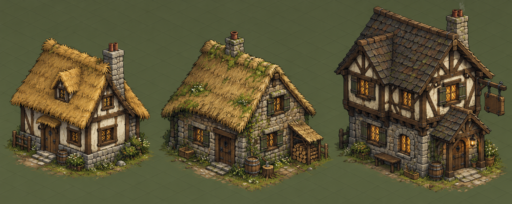

# Direção de arquitetura medieval rural

## Referência visual

O conceito mostra três arquétipos na mesma câmera: casa camponesa enxaimel com taipa, cabana de pedra e taverna com segundo piso, alpendre e letreiro suspenso. Use a imagem como referência para silhueta, relações de materiais e agrupamento de detalhes; ela é uma ilustração conceitual, não um sprite final nem uma planta histórica exata.

## O que a pesquisa sustenta

- A arquitetura medieval variava por região e condição social. A English Heritage descreve o uso recorrente de estruturas de madeira e, em muitas regiões, a permanência do enxaimel ao longo da Idade Média. Os vãos podiam receber taipa, reboco, tijolo ou outros revestimentos locais. [English Heritage — Medieval architecture](https://www.english-heritage.org.uk/learn/story-of-england/medieval/architecture/), [Historic England — timber-framed buildings](https://historicengland.org.uk/advice/technical-advice/flooding-and-historic-buildings/building-construction/timber-framed-buildings/)
- Um exemplo rural de Montgomeryshire combina plinto baixo de pedra, armação de madeira, varas de aveleira entrelaçadas e barro. A casa começou como salão aberto com fogo no centro; a chaminé e o piso superior vieram em alteração posterior. [Museum Wales — Abernodwydd farmhouse](https://museum.wales/collections/online/object/6cd8f731-47dd-3af6-80d4-d35e31ce2840/Abernodwydd-farmhouse/)
- Pedra, palha, telha, ardósia e madeira variavam com disponibilidade e período. A reconstrução arqueológica de Hangleton usa pedra irregular e palha, mas o próprio museu ressalta que a forma e a cobertura originais do telhado são conjecturais. [Weald & Downland Living Museum — Hangleton](https://www.wealddown.co.uk/buildings/medieval-building-hangleton/)
- A palha não é apenas acabamento: inclinação, espessura e remate definem a leitura visual do edifício, com tradições regionais distintas. [Historic England — Conservation of traditional thatch](https://historicengland.org.uk/advice/technical-advice/buildings/thatching-advice)
- Para uma taverna/estalagem de meados do século XV, a University of Leicester descreve o Blue Boar Inn como uma grande construção enxaimel que servia comida, bebida e hospedagem. Isso apoia uma silhueta mais larga e alta que a casa camponesa, sem exigir ornamentação de castelo. [University of Leicester — The Blue Boar Inn](https://le.ac.uk/richard-iii/richard-iii-and-leicester/blue-boar-inn)
- Em edifícios enxaimel, consolos e escoras diagonais podem mostrar como o andar saliente se apoia; exemplos documentados em Canterbury incluem consolos de canto e vigas trabalhadas sob o avanço. [Canterbury History — Timber-framed buildings](https://legacy.canterbury-archaeology.org.uk/www.canterbury-archaeology.org.uk/timber-framed-ok/4591476867.html), [Looking at Buildings — The Jetty](https://lookingatbuildings.org.uk/styles/medieval/walls-and-windows/timber-walls/the-jetty.html)

## Gramática reutilizável proposta

Construa cada edifício como composição de poucas peças paramétricas: plinto de pedra; módulos de parede (madeira aparente com taipa, alvenaria irregular ou madeira escura); duas águas de telhado com variantes de palha, telha ou tabuado; empena; chaminé; porta e janela; e acessórios opcionais como alpendre, letreiro e lenha. A mesma planta e os mesmos vãos podem receber combinações de material e silhueta para produzir casas, cabanas, oficinas, pousadas e tavernas sem manter uma malha artesanal separada para cada prédio.

Para manter leitura no zoom do jogo, priorize primeiro o perfil do telhado, a base de pedra, o ritmo das traves e o recuo da entrada. Deixe padrões de palha, argamassa e madeira como detalhes de UV em resolução pequena. Janelas acesas devem continuar sendo uma camada noturna; fumaça de chaminé e luz de lanterna devem ser efeitos independentes da geometria estática.

## Implementação-piloto e validação

A silhueta agora usa volumes 2.5D montados no renderer comum, sem trocar a planta ou os limites físicos: alpendres têm frontão e pilares, a pousada tem águas-furtadas projetadas, o hotel tem telhado de quatro águas e um segundo piso saliente. As cabanas mantêm empenas tradicionais. As paredes selecionam taipa com traves aparentes ou alvenaria; coberturas usam palha ou telha em atlas UV. A altura da chaminé parte da inclinação real do telhado. O catálogo guarda essas escolhas para que instâncias e cópias mantenham a aparência.

O atlas permanece minúsculo (96×16 px, 748 bytes) e opcional. A luz das janelas continua sendo uma camada de dia/noite; colisores e profundidade seguem os footprints e âncoras que já existiam. Portanto, detalhes visuais como beiral e traves não criam áreas bloqueadas, não mudam rotas e não passam a disputar profundidade com o personagem.

### Refinamento da carpintaria (27/10/2026)

Em vez de acrescentar mais textura à mesma caixa, esta passagem reforça a leitura estrutural: empenas enxaimel recebem frisos internos nas águas e remates curtos nos beirais; o pavimento saliente do hotel recebe consoles triangulares com faces sombreadas, de modo que o avanço pareça apoiado. São detalhes visuais rasterizados junto à fachada estática. Não criam footprint, ocupação, superfície de apoio nem alvo de seleção; as dimensões e âncoras existentes continuam a governar colisão e profundidade.

O formato Wealden — salão central recuado entre alas avançadas sob cobertura comum — é uma próxima forma reutilizável de alto impacto, diferente de apenas variar a empena. Ela deve entrar como volumes estruturais declarados, com footprint e ordenação testados junto com a arte; não deve ser simulada por adornos que atravessem o colisor.

Validação desta passagem: 12 testes direcionados do padrão arquitetônico e arte passaram. A prancha Chromium atualizada renderizou as sete estruturas cadastradas sem erro de página; captura em `logs/architecture-render-check/architecture-contact-sheet.png`, métricas em `logs/architecture-render-check/render-metrics.json`. A validação continua isolada do mapa real, cuja entrada local ainda para no carregamento/autenticação; a captura não substitui a revisão na cena jogável.

### Componentes: janela, materiais, floreira, chaminé e pilares (27/10/2026)

Os detalhes da janela agora têm vão escuro, moldura robusta, duas folhas, montantes menores, lintel/peitoril e venezianas abertas com travessas. Essa composição é uma leitura estilizada, não afirma que todas as casas medievais tinham vidro: a Historic England registra que no começo do período as aberturas domésticas eram em geral sem vidro, com venezianas comuns; luz com painéis é cara e posterior para muitas casas. [Historic England — Traditional Windows](https://historicengland.org.uk/images-books/publications/traditional-windows-care-repair-upgrading/heag039-traditional-windows-revfeb17/)

O atlas UV foi redesenhado sem aumentar seus 96×16 pixels: madeira tem tábuas e veios; alvenaria, blocos de tamanho irregular; telha, sobreposição e juntas alternadas; taipa, reboco mais calmo; plinto, juntas maiores; palha, feixes e pontas soltas. A separação entre estrutura e enchimento segue a descrição de armação de madeira com taipa/trama ou tijolo; a cobertura de palha varia regionalmente e forma parte importante da silhueta. [Historic England — Timber-framed walls](https://historicengland.org.uk/advice/your-home/maintain-repair/walls/), [Historic England — Traditional thatch](https://historicengland.org.uk/advice/technical-advice/buildings/thatching-advice)

As janelas térreas da fachada frontal receberam caixas estreitas com flores e ervas como detalhe fixo da fachada, em paletas diferentes por família de prédio. Fontes iconográficas sugerem plantas em vasos em contextos medievais, mas a floreira contínua sob cada janela é aqui uma licença visual estilizada, não uma alegação de costume universal. [Cambridge Archaeological Journal — medieval gardens and potted plants](https://www.cambridge.org/core/journals/cambridge-archaeological-journal/article/tending-the-contested-castle-garden-sowing-seeds-of-feminist-thought/3110F41FE73F8594F3CA3EC3421B8564)

Chaminés ganharam ombro de pedra, cursos, coroa e duas bocas de tijolo; pilares ganharam pé, fuste, colar e capitel dentro do mesmo retângulo físico já registrado. As floreiras estão presas sob o vão, acima do chão. Nenhum desses itens cria nova colisão, suporte, seleção ou alteração de depth anchor; o atlas atualizado segue carregado como asset de cena na versão 3.

### Quebra dos volumes retangulares (27/10/2026)

Cinco exteriores receberam uma ala frontal lateral com parede, empena e cobertura próprias. As alas variam de lado, largura, profundidade e altura; o hotel combina ala de empena com corpo principal de quatro águas, enquanto pousada e cabanas preservam suas variantes de sótão e cobertura. A composição se inspira na leitura de volumes anexos e avanços estruturais descritos em casas medievais, mas não pretende copiar a planta Wealden. [Vernacular Architecture Group — Wealden Houses Database](https://archaeologydataservice.ac.uk/archives/collections/view/vag_wealden/index.cfm)

As alas ficam dentro do X/Y já bloqueado pelo retângulo do prédio; avançam 0,32 unidade na parede frontal e 0,16 de beiral, total de 0,48, abaixo da margem física atual de 0,60 (raio 0,25 + folga de parede 0,35). As janelas térreas afetadas acompanham a nova face; a aproximação central à porta não muda. A fachada completa continua na âncora estática do edifício e as colunas de alpendre continuam em camadas próprias, sem mover a ordenação do personagem.

Validação: 33 testes direcionados de construção, colisão, profundidade, janelas e materiais passaram; a galeria Chromium mostra sete edifícios, cinco com alas frontais, sem erro JS; catálogo válido com 385 definições/16 assets. Cena completa não foi conferida no mapa real nesta passagem; a galeria é uma verificação isolada do renderer.

Validação local desta passagem:

- 42 testes direcionados de materiais, projeção de fachada, padrão de edifícios, catálogo, colisão da casa, portas, postes e ordenação de profundidade passaram. A suíte de profundidade também conferiu 213 móveis em quatro orientações; os testes de caminho verificaram móveis alcançáveis, vãos e sprites junto às paredes.
- A validação do catálogo passou com 385 definições e 16 assets externos dentro do orçamento.
- A prancha executável do Chromium renderizou sete fachadas sem erros de página e cobriu taipa, pedra, palha e telha. Ela está em `logs/architecture-render-check/architecture-contact-sheet.png`.
- A tentativa de captura da cena completa no navegador local parou na tela inicial de carregamento/autenticação (11,5%); por isso esta rodada não conta como aprovação visual dentro do mapa. A galeria isola o renderer real e as provas de colisão/profundidade continuam passando.
- Microbenchmark de 60 repetições por fachada, depois de aquecimento, mediu 1,55–1,76 ms/fachada com as novas formas UV e 2,42–2,70 ms no fallback, no Chromium headless deste ambiente. O custo da primeira rasterização cresceu com as peças extras; as fachadas ficam no cache estático do jogo, então essas operações não se repetem a cada frame. É um microbenchmark sujeito ao ruído do host, não FPS total em celulares.
- Os parâmetros visuais acrescentam 520 bytes ao catálogo embutido (262.214 bytes no total); a textura opcional pesa 748 bytes e não envia mensagens adicionais pelo WebSocket. Não há tráfego por frame nem mudança no protocolo de movimento. O teste multiplayer local, executado após as mudanças, mediu 51,8 ms entre comando e cliente remoto e 16 snapshots/s; isso valida que o caminho atual segue dentro do limite do teste, mas não é uma medição da latência de produção.

O resultado ainda é uma composição procedural de referência, não arte final pintada à mão. O próximo ajuste visual deve ocorrer em captura dentro do cenário completo e em tela pequena; a galeria isolada valida alinhamento e leitura dos volumes, mas não substitui uma revisão artística no mapa.
